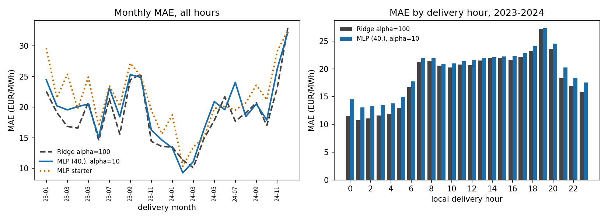

# D. Multi-layer perceptron

Build a feed-forward neural network that predicts all 24 hourly DK1 day-ahead
prices together. Test whether its shared hidden layers improve on the project
lead's frozen Ridge baseline on the same delivery hours. This model is the
supervised learning extension. Its aligned predictions can also be used in the
team's clustering and Apriori analyses.

Run the [shared benchmark](../BENCHMARK.md) with `--model mlp`. Outputs are in `results/team/mlp/`.

## What to investigate

1. Record the unchanged starter's results. It has two hidden layers (80 and
   40 units), L2 penalty `alpha=1.0`, a 400-iteration budget and a fixed random
   seed. Inputs and each hourly target are standardized using the current
   training window only. Predictions are converted back to EUR/MWh.
2. Compare one change at a time, starting with a smaller network such as
   `(40,)` or a different L2 penalty. Use chronological validation when
   choosing settings. The MLP's automatic early stopping uses a randomly
   split validation subset, so it is disabled in the starter. Record any
   convergence warning, its impact on runtime and the results of any
   larger iteration budget.
3. Compare with Ridge on matching timestamps. Report MAE, RMSE, the ±5% hit
   count and eligible count, negative-price MAE and its sample size, and
   fit time. Check whether any change is concentrated at particular hours.
   The two benchmark years are historical development data.
4. Send the project lead your model code, settings and a short account of
   the hypothesis, results, limitations and your individual contribution.
   Include `results/team/mlp/metrics.csv`, `results/team/mlp/timing.csv`, and
   `results/team/mlp/run.json`, and transfer `results/team/mlp/predictions.csv.gz` through an
   approved private channel when its use is authorized.

Edit `model.py` while preserving `build_model()`: it must return an unfitted
scikit-learn estimator that accepts one feature row per day and predicts 24
finite values per row. Leave the shared data, evaluation periods and output
schema unchanged for the main comparison.

## Delivered by D

Decision: **one hidden layer of 40 units, `alpha=10.0`, `max_iter=800`**, with
input and target scaling inside the pipeline (starter: two layers `(80, 40)`,
`alpha=1.0`, 400 iterations). Settings were chosen on rolling validation months
of 2023 only; 2024 was not used for any choice. All findings are exploratory:
2023–2024 are development years.

Hypothesis: because all 24 delivery hours are predicted by one shared hidden
layer, the network can in principle learn the correlation between hours (the
daily price shape) instead of fitting 24 unrelated linear models, so a small,
strongly penalised network might beat Ridge. The risk is the opposite one: 604
collinear inputs and roughly 1,500–2,150 training days give a dense network very
little data per weight, and the monthly refit leaves no room for a slow
optimiser.

| File | Purpose |
| --- | --- |
| `mlp.ipynb` | Evidence for every choice with saved outputs: the starter's fit and convergence warning, the rolling validation grids, the iteration-budget check, the benchmark comparison and the per-hour diagnosis. |
| `model.py` | The chosen network, verified by Part 7 of the notebook. |
| `starter.py` | The unchanged starter as its own entry point: it builds the shipped `(80, 40)`, `alpha=1`, 400-iteration network and calls the shared runner, so `results/team/mlp-starter/` is reproducible from a fresh checkout without editing `model.py` or shared code. |
| `tuning.py` | Rolling 2023 validation, three prespecified stages (sizes and L2, then combinations, then a narrower grid plus target transform). Writes `summary/validation_grid_stage<1-3>.csv` and `summary/validation_months_stage<1-3>.csv`. |
| `screen.py` | One-fit screen on a single chronological split (fit 2019–2022, score 2023) used to check larger iteration budgets before paying for 12 refits. Writes `summary/screen_2023.csv`. |
| `analysis.py` | Per-month and per-hour errors, plus the MAE difference against Ridge with three intervals: an i.i.d. bootstrap over delivery days, moving-block bootstraps over 7 and 14 days, and a Newey–West interval. Writes `summary/per_month_mae.csv`, `summary/per_hour_mae.csv`, `summary/paired_bootstrap.csv` and `summary/mlp_diagnostics.png`. |
| `summary/` | The tables above, committed so the numbers can be checked without rerunning the fits. |

Run order, from the repository root, with the project environment. `model.py`
always holds the tuned network, so the starter has its own entry point
(`starter.py`); `--output` alone would only rerun the tuned model into another
directory.

```sh
python team/d-mlp/starter.py                        # unchanged starter -> results/team/mlp-starter (~7 min)
python scripts/run_team_benchmark.py --model ridge --data   # frozen baseline -> results/team/ridge
python team/d-mlp/tuning.py --stage 1               # sizes and L2 (~10 min)
python team/d-mlp/tuning.py --stage 2               # combinations that stage 1 suggested (~6 min)
python team/d-mlp/tuning.py --stage 3               # narrower grid, target transform (~6 min)
python scripts/run_team_benchmark.py --model mlp --data     # chosen settings, 2023-2024 (~2 min)
python team/d-mlp/analysis.py                       # needs ridge + mlp + mlp-starter (<1 min)
```

`mlp.ipynb` walks through the same steps; it reuses the summary files for the
long grids and refits only the small demonstrations. `results/team/` is
Git-ignored, so all three prediction directories have to be regenerated by the
commands above before `analysis.py` or the hand-off can run.

### The starter is not competitive, and its warning is not the reason

The unchanged starter scores MAE 22.46 in 2023 and 20.37 in 2024 against Ridge's
18.78 and 18.34, i.e. 3.68 and 2.03 EUR/MWh worse. It also emits
`ConvergenceWarning` in 9 of the 12 refits of 2023 (mean 376 epochs of the 400
allowed). Raising the budget to 800 removes the warning and changes nothing:
mean 442 epochs, MAE 22.462 vs 22.457, RMSE 30.432 vs 30.581 — the optimiser
simply stops improving after roughly 440 epochs. The gap to Ridge is therefore a
bias/variance problem of the network, not an optimisation budget that was cut
short. (The 10–20 s per refit also makes an iteration sweep cheap, so this was
checked before any other change.)

### Validation protocol and the settings that were tried

Each month of 2023 is predicted by a model fitted on all earlier days, exactly
as the benchmark refits, and scored on the same hourly observations with
`team_benchmark_core.metric`. This reproduces the benchmark's own 2023 columns
to six decimals for the settings that were run both ways (starter 22.4567,
chosen 20.2161), so the validation column is directly comparable. Settings were
fixed in advance: MAE and RMSE were the selection criteria, one change at a time
from the starter, and only the 2023 months were used.

| Setting | MAE | RMSE | ±5% hits / eligible | Months worse than Ridge |
| --- | ---: | ---: | ---: | ---: |
| Ridge, `alpha=100` (frozen) | **18.780** | **26.654** | 1,575 / 7,738 (20.4%) | — |
| Stage 1, one change at a time from the starter | | | | |
| Starter `(80,40)`, `alpha=1`, 400 iters | 22.457 | 30.581 | 1,192 / 7,738 (15.4%) | 11 / 12 |
| `(40,)`, `alpha=1` | 22.658 | 30.821 | 1,228 / 7,738 (15.9%) | 12 / 12 |
| `(160,80)`, `alpha=1` | 22.059 | 30.115 | 1,247 / 7,738 (16.1%) | 12 / 12 |
| `alpha=0.1` | 24.300 | 32.963 | 1,085 / 7,738 (14.0%) | 12 / 12 |
| `alpha=10` | 21.342 | 29.323 | 1,225 / 7,738 (15.8%) | 10 / 12 |
| `alpha=100` | 26.304 | 34.400 | 868 / 7,738 (11.2%) | 12 / 12 |
| Stage 2, from the `alpha=10` result | | | | |
| `(40,)`, `alpha=10` | **20.216** | **27.794** | 1,301 / 7,738 (16.8%) | 10 / 12 |
| `(24,)`, `alpha=10` | 20.507 | 28.534 | 1,280 / 7,738 (16.5%) | 11 / 12 |
| `(80,)`, `alpha=10` | 20.709 | 28.340 | 1,213 / 7,738 (15.7%) | 11 / 12 |
| `(160,80)`, `alpha=10` | 20.582 | 28.464 | 1,228 / 7,738 (15.9%) | 9 / 12 |
| `(40,)`, `alpha=30` | 21.105 | 28.689 | 1,173 / 7,738 (15.2%) | 9 / 12 |
| `(80,40)`, `alpha=30` | 22.057 | 29.990 | 1,170 / 7,738 (15.1%) | 11 / 12 |
| Stage 3, around the chosen setting | | | | |
| `(40,)`, `alpha=5` | 20.466 | 28.205 | 1,337 / 7,738 (17.3%) | 11 / 12 |
| `(40,)`, `alpha=20` | 20.816 | 28.475 | 1,184 / 7,738 (15.3%) | 11 / 12 |
| `(32,)`, `alpha=10` | 21.148 | 28.912 | 1,274 / 7,738 (16.5%) | 11 / 12 |
| `(40,)`, `alpha=10`, 800 iters | 20.216 | 27.794 | 1,301 / 7,738 (16.8%) | 10 / 12 |
| `(40,)`, `alpha=10`, quantile target | 24.056 | 32.486 | 1,020 / 7,738 (13.2%) | 11 / 12 |

What the grid says. **Capacity does not help**: going from 40 to 160 hidden units
changes validation MAE by at most 0.6 EUR/MWh at any penalty, in the wrong
direction at `alpha=10`, and the extra units cost 2–3× the fit time.
**Regularisation helps up to a point**: at the starter's 80×40 shape the best
penalty is around 10 (−1.1 EUR/MWh against `alpha=1`), and `alpha=100` collapses.
The 40-unit, `alpha=10` combination combines both effects: 20.216 MAE, i.e. 2.24
EUR/MWh better than the starter. Going below 10 at the chosen shape is worse
(`alpha=5` → 20.47), and 24 or 32 units are 0.3–0.9 worse than 40, so the optimum
is flat but real. Replacing the target scaler with a normal quantile transform is
clearly harmful (24.06): the prices have long right tails, and equalising them
destroys the information that the benchmark's hit rate rewards.

**Iteration budget.** `max_iter=800` and `max_iter=400` give identical
predictions for the chosen setting (mean 268 epochs, no warning), so the shipped
800 is only insurance against a refit that needs more. It costs nothing because
training stops on the `tol` criterion, not on the cap.

### Shared benchmark, chosen settings (monthly expanding refits)

| Model | Year | MAE | RMSE | ±5% hits / eligible | Negative-price MAE (hours) | Fit time, 24 refits |
| --- | --- | ---: | ---: | ---: | ---: | ---: |
| Ridge, `alpha=100` (frozen) | 2023 | 18.78 | 26.65 | 1,575 / 7,738 (20.4%) | 31.56 (281) | 2.1 s |
| MLP starter `(80,40)`, `alpha=1` | 2023 | 22.46 | 30.58 | 1,192 / 7,738 (15.4%) | 36.09 (281) | 409.8 s |
| **MLP `(40,)`, `alpha=10`** | 2023 | **20.22** | **27.79** | 1,301 / 7,738 (16.8%) | 33.74 (281) | 107.7 s |
| Ridge, `alpha=100` (frozen) | 2024 | 18.34 | 29.52 | 1,356 / 7,620 (17.8%) | 19.43 (375) | (same run) |
| MLP starter `(80,40)`, `alpha=1` | 2024 | 20.37 | 31.43 | 1,055 / 7,620 (13.8%) | 21.40 (375) | (same run) |
| **MLP `(40,)`, `alpha=10`** | 2024 | **19.19** | **30.07** | 1,225 / 7,620 (16.1%) | 24.38 (375) | (same run) |

Fit times are the sum of `fit_seconds` in `timing.csv` for both years, on a
Windows laptop with an 11th Gen Intel Core i5-11300H (the runner limits BLAS to
2 threads). Timing is machine-specific, so compare rows within this table rather
than with other members' numbers. The chosen network costs about 4.5 s per refit
against 17 s for the starter and 0.09 s for Ridge: roughly 50× Ridge on fit time,
but only a few minutes for the whole two-year run.

### Does the improvement hold, and where does it come from?

The direction is stable: the chosen network beats the starter in both years
(−2.24 MAE in 2023, −1.18 in 2024), and 2024 was untouched while tuning. It is
still behind Ridge in both years, but how much of that is systematic differs by
year. Hourly errors are strongly autocorrelated, so a bootstrap that resamples
individual days is too narrow; `analysis.py` therefore reports three intervals
for the MAE difference (candidate − Ridge), and the dependence-aware ones are
the ones to quote:

| Comparison | MAE difference | i.i.d. days | 7-day moving blocks | 14-day moving blocks | Newey–West (7 lags) |
| --- | ---: | --- | --- | --- | --- |
| MLP `(40,)`, `alpha=10` vs Ridge, 2023 | +1.44 | [0.70, 2.18] | [0.64, 2.21] | [0.61, 2.27] | [0.63, 2.24] |
| MLP `(40,)`, `alpha=10` vs Ridge, 2024 | +0.85 | [0.12, 1.60] | [−0.04, 1.75] | [−0.07, 1.90] | [−0.07, 1.77] |
| Starter vs Ridge, 2023 | +3.68 | [2.81, 4.58] | [2.75, 4.64] | [2.63, 4.80] | [2.68, 4.67] |
| Starter vs Ridge, 2024 | +2.03 | [1.07, 3.00] | [0.85, 3.30] | [0.87, 3.32] | [0.83, 3.24] |

All intervals are 95%; 2,000 resamples, block lengths in delivery days, Newey–West
on the daily error differences with Bartlett weights.

So in **2023 the network is worse than Ridge with reasonable confidence**, while
in **2024 Ridge has the lower observed MAE but the evidence for a systematic
difference is inconclusive once dependence across delivery days is accounted
for** — the interval that ignores that dependence is the narrow one that appears
significant. The starter's gap, by contrast, is unambiguous in both years. An
independent check by the project lead with contiguous seven-day blocks and a
Newey–West interval gave the same picture (2024 interval −0.08 to +1.82), which
is why the conclusion here is deliberately weaker than the raw ranking.

The gain is **not consistent across months**, which is the sense in which the
course asks whether it is worth the extra training time. The MLP beats Ridge in
2 of 12 months in 2023 and 6 of 12 in 2024, and its largest losses are 2024-07
(+6.3), 2023-04 (+3.5) and 2024-11 (+3.1) while its largest wins are 2024-02
(−2.1) and 2024-06 (−2.2). Averages hide this: the model is not uniformly a bit
worse, it is occasionally better and sometimes clearly worse, notably in a
volatile July.

The error is **concentrated in specific hours**. The MLP is worse than Ridge at
all 24 clock hours, but the difference is +2.0 EUR/MWh on average over the night
hours 00–05 and 21–23 (largest at 00:00, +3.0) against +0.6 over 07–19. Hours
00–05 are low-price hours in which Ridge is very accurate (MAE 10.7–13.5), so the
shared all-hour MAE is dominated by exactly the hours where the network cannot
match a linear model; during the expensive evening hours the two models are much
closer. Negative-price hours remain the weak point of both models and the MLP is
worse there too (33.74 vs 31.56 in 2023, 24.38 vs 19.43 in 2024).



### What I learned, and limitations

A 604-input problem with only 1,450–2,150 training days is close to the worst
case for a dense network: the inputs are collinear daily price curves, the target
has long tails and the signal that a linear model already captures is mostly
additive. Adding hidden units buys nothing, because the network has too few
independent days to learn interactions that survive a monthly refit; the useful
control is regularisation, and the mild negative result — an MLP that improves on
its own starting point, trails Ridge in 2023 and is only indistinguishable from
it in 2024 — is the substantive finding. For the
team's purposes the MLP is useful as a *different* error source for clustering
and Apriori (its errors are concentrated at night and in volatile months, unlike
Ridge's), and as a check that the large-error regimes identified with the tree
models are not an artefact of one model family.

Limitations: the `alpha`/width grid is coarse and was searched on 2023, so the
validation numbers are optimistic for the *chosen setting* even though 2024 is
clean; the 2024 ranking could differ under another seed (a single fixed
`random_state=42` is used, as in the starter — seed variance was not measured);
hourly errors are autocorrelated across consecutive delivery days, which is why
the block and Newey–West intervals above, not the i.i.d. one, are the ones
quoted; and the inputs are the shared 10:00 approximation whose release and
revision times are only partly audited. Since the deliverable keeps
`build_model()`, the predictions in `results/team/mlp/predictions.csv.gz` are
aligned with the other models for the lead's ensemble and error-rule analyses.

My contribution: the starter's benchmark run and its reproducible entry point
(`starter.py`), the validation harness (`tuning.py`, `screen.py`), the three grid
stages, the diagnostics (`analysis.py`) including the dependence-aware intervals,
the chosen model and this write-up. Price and weather data are adapted from the
sources and licences listed in `../DATA_LICENSE.md`.

